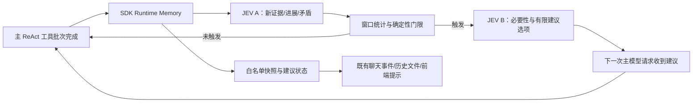

# Runtime Memory 与 BAI 应用接入

本阶段把原生主 Agent 的执行反馈、收益窗口、JEV 判断、主模型建议及后续效果接入 jiuwenswarm。SDK 负责判断算法，应用负责配置、客户端、事件、聊天提示和历史。成本预测不在后续路线内；恢复层由独立实现以后接入。

## 本地双仓联调

- 应用分支：`runtime-bai-adaptation`。
- SDK：相邻目录 `../agent-core` 的 `react-runtime-bai` 分支，editable 安装；直接使用该分支当前工作区代码。
- `pyproject.toml` 的 `[tool.uv.sources].openjiuwen` 已指向本地路径，主依赖和 harmony 依赖不再声明旧远端提交。
- 在已有应用 `.venv` 中执行 `./scripts/use-local-agent-core.ps1`。脚本核对分支，再替换 SDK，最后验证实际导入路径；不会切分支。目录不相邻时传 `-AgentCorePath <路径>`。
- 启动用已有 `.venv/Scripts/python.exe`、`.venv` 中的入口程序，或 `uv run --no-sync jiuwenswarm-start`。SDK Python 代码改动直接生效，已有进程需要重启才会重新导入。

**当前依赖限制：** 完整 `uv lock` 未成功。此 SDK 要求 `opentelemetry-sdk>=1.45.1`，应用的 A2UI/Google ADK 与 `google-genai<2` 组合无法同时满足；直接升级 GenAI/ADK 会扩展本次适配范围。原 `uv.lock` 保留不变，不能宣称已经生成新的全量锁文件。联调脚本使用 `uv pip install --no-deps --no-build-isolation --editable`，复用现有应用依赖，仅替换 SDK。联调期间不要用普通 `uv sync` / `uv run` 重解依赖，也不要用 `--frozen` 把旧远端 SDK 装回来。干净环境、全平台依赖安装和生产打包尚需单独解决兼容性并生成锁文件。

## 配置

在当前工作区生效的 `config.yaml` 合并下面配置；`jiuwenswarm/resources/config.yaml` 是新工作区模板，不覆盖现有工作区配置。模板默认关闭，开启后建议先 observe 校准，再切 active。没有有效 JEV 凭据时不启动监控，原 Agent 仍可运行；日志记录初始化失败类型。

```yaml
execution_guard:
  runtime_monitor:
    enabled: true
    mode: observe  # active 才将建议加入主模型请求
    backend: jev
    jev:
      api_key: "${JEV_API_KEY:-}"
      api_base: https://api.typesafe.ai
      model_name: jev-latest
    parameters:
      window_size: 5
      warmup_steps: 2
      low_gain_steps: 3
      conflict_threshold: 2
      assessment_timeout: 1.5
      review_timeout: 1.5
```

通过既有密钥/环境配置提供 `JEV_API_KEY`，不要把真实值提交到仓库。`backend: llm` 会使用当前主 Agent 已配置的 chat model 作为 evaluator，不单独拥有或关闭它；需要较长响应时间时在 parameters 中调整 A/B 超时。默认 JEV 客户端独立创建且 `max_retries=0`。SDK `RuntimeEvaluator`、`review_evaluator` 和 `EvidenceAdapter` 接口仍可用于后续定制。

适配器创建及 reload 都执行装配。配置没变则复用 monitor/client；参数无效时保留上一次可用配置；关闭或 cleanup 释放客户端。mode/backend 改变会切换评分版本并在下次绑定时重新建立收益窗口，避免旧的 active 建议或已耗尽的观察片段污染新模式。修改量表或 LLM 模型含义时，应同步调整 `parameters.rubric_version`。

## 执行与触发



一步是一个完整工具批次；并行工具不各算一轮，暂停和重试不虚增轮次。主模型提出并执行真实动作；JEV 只回答有限判断及建议选项，不执行工具。

| 判断 | 默认算法 |
| --- | --- |
| 收益 | 可信验收首次通过 1；有用新证据 0.5；有依据的状态改善 0.25；无收益 0；不确定为未知 |
| 连续低收益 | 探索宽限 2 轮后，连续 3 轮低于 0.25；未知打断计数 |
| 窗口低收益 | 最近 5 轮、有效评估比例至少 0.8，按 SDK 的窗口门限判断；收益下界不冒充完整零收益 |
| 其他候选 | 重复动作/结果、2 对新的独立冲突、验收被推翻、明显偏离、连续未知 |
| 控频 | 有活动建议不重复复核；默认冷却 2 轮；连续无进展片段最多 2 条建议 |
| 效果 | 真实请求送达后观察后续 2 轮，区分 improved / no_observed_improvement / inconclusive |

正常评估步最多一次 JEV A；触发后增加一次 B，不增加独立后台执行循环。异常/超时降级，未知不记为零。建议是 CONTINUE / VERIFY / REPLAN；有可信 anchor 时才会出现 BACKTRACK，含义仅为重审推理。主模型可以不采纳，是否送达、是否响应、是否观察到改善分别记录。最终答复不额外启动一轮监督。

本阶段只使用 SDK 的通用工具观察提取：没有业务 `criterion/version/proof_ref` 的结果，**已验证进展保持 0**。TODO 完成、模型自述、工具返回 success 均不能直接算作验收。后续按业务工具补 EvidenceAdapter；不在应用复制收益算法。

## 事件与历史契约

`RuntimeMonitor.on_update` 在评估边界及收尾发布独立快照，默认通知限时 0.25 秒。应用只投影白名单字段，不发送目标全文、工具参数、原始证据和密钥。

- `chat.runtime_monitor`：`schema_version=runtime-monitor.v1`，task_id、generation、goal_version、revision、mode、窗口统计、最近步骤和最多 8 条建议摘要。通过既有 facade/history 写入诊断记录；不渲染为助手正文。
- `chat.notice` / `notice_type=runtime_intervention`：展示原因、建议、窗口指标和后续效果。稳定 notice_id 为 `generation:advice_id`；同一建议状态更新替换同一条聊天系统提示。WebSocket 去重区分不同建议及不同状态，历史恢复保留最后状态。
- 通知是尽力投递；发送失败不会阻塞 Agent。成功发送后才更新去重缓存，后续快照可重试；SDK Session 中的 Runtime Memory 才是运行诊断状态。它不是恢复检查点，也不保证重启后的投递 exactly-once。

目前接入 `JiuWenSwarmDeepAdapter` 创建的原生主 Agent，包括应用常驻交互轮；不自动为三方 harness/provider 或每个 subagent 启用监控。没有新增业务完成判定、权限门禁或聊天页面。

## 联调证据与后续扩展

应用专项测试使用真实 create_deep_agent、adapter 工厂、invoke 和 run_one_round 入口，JEV、主模型和工具结果使用可控替身：active 的下一步实际转为 verify，observe 保持原动作；验证建议送达、效果更新、客户端关闭、会话隔离、失败重试及实际历史文件写入。前端测试覆盖 live notice ID、传输去重、历史末状态及已有历史行为。没有执行真实 JEV/LLM 调用或完整浏览器端到端测试。

后续按顺序推进：为主要业务工具补可信证据/验收适配；用代表性轨迹在 observe 模式标注误触发与延迟；校准后逐步开启 active。恢复层以后通过独立接口对接，当前 BACKTRACK 不调用任何恢复动作。详细 SDK 算法见相邻仓库的 [运行监控说明](../../agent-core/docs/runtime_monitor.md)。
