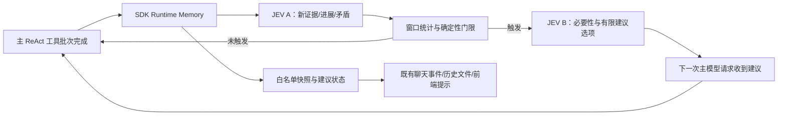

# Runtime Memory 与 BAI 应用接入

本阶段把原生主 Agent 的执行反馈、收益窗口、JEV 判断、主模型建议及后续效果接入 jiuwenswarm。SDK 负责判断算法，应用负责配置、客户端、事件、聊天提示和历史。成本预测不在后续路线内；恢复层由独立实现以后接入。

## 本地双仓联调

在相邻目录放置两个 checkout。应用使用 `runtime-bai-adaptation`（官方 `releases/0.2.9`），`../agent-core` 使用 `react-runtime-bai`（官方 `v0.1.21`）。在应用仓根目录执行：

```powershell
uv sync --locked
uv run --locked jiuwenswarm-start
```

应用沿用发布版 `openjiuwen==0.1.21` 及其 extras 约束。`[tool.uv.sources]` 和 `uv.lock` 将该版本解析为 `../agent-core` 的 editable 安装，Gateway、协议与其他包使用发布锁中的版本。切换 SDK 源码后重启应用即可加载改动。

若 SDK 在其他目录，先准备好同发行版本的应用环境，再运行 `./scripts/use-local-agent-core.ps1 -AgentCorePath <路径>`。脚本校验 SDK 分支、替换已有环境的 editable 安装并核对实际导入路径。这种自定义目录用 `.venv/Scripts/python.exe` 或 `uv run --no-sync` 启动，避免同步时恢复锁中的相邻目录。

## 配置

在当前工作区生效的 `config.yaml` 合并下面配置；`jiuwenswarm/resources/config.yaml` 是新工作区模板，不覆盖现有工作区配置。模板默认关闭，开启后建议先 observe 校准，再切 active。没有有效 JEV 凭据时不启动监控，原 Agent 仍可运行；日志记录初始化失败类型。

```yaml
execution_guard:
  runtime_monitor:
    enabled: true
    mode: observe  # active 才将建议加入主模型请求
    backend: jev
    parameters:
      window_size: 5
      warmup_steps: 2
      low_gain_steps: 3
      conflict_threshold: 2
      assessment_timeout: 1.5
      review_timeout: 1.5
```

JEV 连接统一在 **设置 → 模型 → 决策模型** 配置，和浏览器 Agent 共用 `browser.decision` 的 provider、api_base、model、api_key_env。TypeSafe 使用 `TYPESAFE_API_KEY` 和 `/systemone`，OpenRouter 使用 `OPENROUTER_API_KEY` 和 `/decisions`，自定义地址使用 `JEV_CUSTOM_API_KEY` 和 TypeSafe 协议。前端密钥仍由现有配置服务保存，运行时按既有方式解密，不进入 YAML、通知或指纹明文。

浏览器的 llm/shadow/hybrid、重试、超时和决策次数是独立策略，不控制 BAI。BAI 继续使用自己的 enabled/mode/parameters；JEV 客户端 `max_retries=0`，A/B 使用自身超时。`backend: llm` 复用当前主模型，不读取 JEV 配置或关闭共享模型。SDK 的 RuntimeEvaluator、review_evaluator、EvidenceAdapter 替换接口保留。

**旧配置迁移：** 删除 `execution_guard.runtime_monitor.jev` 整段以及仅为 BAI 设置的 `JEV_API_KEY` 引用，在决策模型中配置同一连接。新配置严格拒绝该旧字段，不再提供第二套连接来源。本次改动不会自动覆盖现有工作区配置文件。

创建及 reload 都执行装配。配置未变复用 client/window；只修改浏览器模式、显示名称或浏览器预算不重建 BAI。轮换共享密钥重建客户端但保留评分窗口；JEV 模型/端点、BAI mode/backend 改变则切换评分 generation。清空当前共享密钥会解绑 BAI 并关闭旧客户端，后续重新配置后可重建；其他无效重载保留上一次有效配置。关闭或 cleanup 同样释放客户端。LLM 模型语义或量表变化时仍需更新 `parameters.rubric_version`。

## 执行与触发



一步是一个完整工具批次；并行工具不各算一轮，暂停和重试不虚增轮次。主模型提出并执行真实动作；JEV 只回答有限判断及建议选项，不执行工具。

| 判断 | 默认算法 |
| --- | --- |
| 收益 | 可信验收首次通过 1；有用新证据 0.5；有依据的状态改善 0.25；无收益 0；不确定为未知 |
| 连续低收益 | 探索宽限 2 轮后，连续 3 轮低于 0.25；未知打断计数 |
| 窗口低收益 | 最近 5 轮、有效评估比例至少 0.8，按 SDK 的窗口门限判断；收益下界不冒充完整零收益 |
| 其他候选 | 重复动作/结果、2 对新的独立冲突、验收被推翻、明显偏离、连续未知 |
| 控频 | 有活动建议不重复复核；默认冷却 2 轮；连续无进展片段最多 2 条建议 |
| 效果 | 真实请求送达后观察后续 2 轮，区分 improved / no_observed_improvement / inconclusive |

正常评估步最多一次 JEV A；触发后增加一次 B，不增加独立后台执行循环。异常/超时降级，未知不记为零。建议是 CONTINUE / VERIFY / REPLAN；有可信 anchor 时才会出现 BACKTRACK，含义仅为重审推理。主模型可以不采纳，是否送达、是否响应、是否观察到改善分别记录。最终答复不额外启动一轮监督。

### 登记可以裁决分歧的文件

默认按通用工具结果监控。对于来源已知的业务材料，可在工作区的 `execution_guard.runtime_monitor` 下登记原生 `read_file` 返回的绝对路径、预期内容摘要，以及材料涉及的对象、属性和版本。副本登记同一组事实键，签署原件另设 `adjudicates: true`。一份文件可以覆盖多个事实。

```yaml
execution_guard:
  runtime_monitor:
    evidence_files:
      "/srv/warehouse/aisle-record.txt":
        result_sha256: "84c30be6ede535eecebb130d0a1f2ec7fdfc7dff7e640bd8d776d553dfdc45f2"
        facts:
          - {subject: A7, property: aisle, version: R4, adjudicates: true}
```

示例摘要对应一个单行结果，可用 `hashlib.sha256("     1\tRack A7: aisle 4.".encode("utf-8")).hexdigest()` 复算。应根据已核对的完整预期文本计算摘要，包含原生工具返回的行号与制表符。运行时使用实际 `ToolOutput.data["content"]` 核对摘要。文件内容改变、读取指定页/行范围、工具失败时，按通用证据处理。调整登记表会开启新的监控代次。

同一版本的矛盾副本按独立分歧计数。已登记原件关闭分歧后仍可追查每个证据对。业务验收计数只消费可信的 `Verification`，单凭原件裁决或工具成功不会增加该计数。

## 事件与历史契约

`RuntimeMonitor.on_update` 在评估边界及收尾发布独立快照，默认通知限时 0.25 秒。应用只投影白名单字段，不发送目标全文、工具参数、原始证据和密钥。

- `chat.runtime_monitor`：`schema_version=runtime-monitor.v1`，task_id、generation、goal_version、revision、mode、窗口统计、最近步骤和最多 8 条建议摘要。通过既有 facade/history 写入诊断记录；不渲染为助手正文。
- `chat.notice` / `notice_type=runtime_intervention`：展示原因、建议、窗口指标和后续效果。稳定 notice_id 为 `generation:advice_id`；同一建议状态更新替换同一条聊天系统提示。WebSocket 去重区分不同建议及不同状态，历史恢复保留最后状态。历史查询白名单保留 chat.notice，支持 JSONL 的 index/cursor 分页和旧 JSON 的 index 分页；诊断快照不进入聊天历史分页，诊断和提示不作为模型上下文恢复输入。
- 通知是尽力投递；发送失败不会阻塞 Agent。成功发送后才更新去重缓存，后续快照可重试；SDK Session 中的 Runtime Memory 才是运行诊断状态。它不是恢复检查点，也不保证重启后的投递 exactly-once。

目前接入 `JiuWenSwarmDeepAdapter` 创建的原生主 Agent，包括应用常驻交互轮；不自动为三方 harness/provider 或每个 subagent 启用监控。没有新增业务完成判定、权限门禁或聊天页面。

## 联调证据与后续扩展

应用专项测试使用真实 create_deep_agent、adapter 工厂、invoke 和 run_one_round 入口，JEV、主模型和工具结果使用可控替身：active 的下一步实际转为 verify，observe 保持原动作；验证建议送达、效果更新、客户端关闭、会话隔离、失败重试及实际历史文件写入。前端测试覆盖 live notice ID、传输去重、历史末状态及已有历史行为。没有执行真实 JEV/LLM 调用或完整浏览器端到端测试。

后续按顺序推进：为主要业务工具补可信证据/验收适配；用代表性轨迹在 observe 模式标注误触发与延迟；校准后逐步开启 active。恢复层以后通过独立接口对接，当前 BACKTRACK 不调用任何恢复动作。详细 SDK 算法见相邻仓库的 [运行监控说明](../../agent-core/docs/runtime_monitor.md)。


发布基线、共享配置与验证记录见[应用实施记录](../.agents/agent-docs/features/F_20261113_1109_runtime-bai-shared-jev.md)；英文用法见 [Runtime monitor](en/runtime-monitor.md)。
